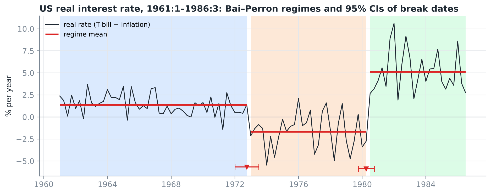

# Structural Break Tests in Time Series

**Team:** Pikuleva, Tolmacheva, Beznosenkova, Tsurkan

**Paper:** Muthuramu P., Uma Maheswari T. (2019). _Tests for Structural Breaks in Time Series Analysis: A Review of Recent Development._ Shanlax International Journal of Economics, 7(4), 66–79. [DOI: 10.34293/economics.v7i4.628](https://doi.org/10.34293/economics.v7i4.628) (open access, CC BY-SA 4.0 — a copy is in `paper/`).

## Contents

| Part         | File                                                       | Description                                                                                                                                      |
| ------------ | ---------------------------------------------------------- | ------------------------------------------------------------------------------------------------------------------------------------------------ |
| Paper review | [`review/review.md`](review/review.md)                     | summary, walkthrough of the methods with formulas, critique (including errors we found), relevance for finance, summary of our empirical results |
| Code         | [`src/structbreaks/`](src/structbreaks)                    | every test from the paper implemented **from scratch** with numpy/scipy                                                                          |
| Analysis     | [`notebooks/analysis.ipynb`](notebooks/analysis.ipynb)     | executed notebook: validation of the implementation, 3 financial case studies, Monte Carlo                                                       |
| Tests        | [`tests/test_structbreaks.py`](tests/test_structbreaks.py) | 10 correctness checks                                                                                                                            |

## Key results

| Case                | Data                                 | Result                                                                                                                            |
| ------------------- | ------------------------------------ | --------------------------------------------------------------------------------------------------------------------------------- |
| Validation          | Nile flow 1871–1970                  | sup-F = 75.93, break in 1898 — matches R `strucchange`                                                                            |
| CAPM beta           | food industry, 1960–2002 (K. French) | Quandt–Andrews: break in Jul 1996, β 0.89 → 0.38; the Chow test "finds" a break at 3 of 4 arbitrary dates; CUSUM misses the break |
| The paper's example | US real interest rate, 1961:1–1986:3 | Bai–Perron: 2 breaks — **1972:4 and 1980:2** (the paper: 1972:3 and 1980:3, inside our 95% CIs)                                   |
| Volatility regimes  | S&P 500, 1950–2018                   | 6 breaks at ε = 0.10; the number of breaks ranges from 2 to 8 depending on the trimming ε                                         |
| Monte Carlo         | T = 200                              | CUSUM has no power against a beta shift; the size of the Chow test under heteroskedasticity is up to 34% instead of 5%            |
| Checking the paper  | Table 1                              | arithmetic error: 117 admissible segments in the paper vs 107 from its own formulas                                               |



## Implemented methods

| Module                  | Methods                                                                                                                                                           |
| ----------------------- | ----------------------------------------------------------------------------------------------------------------------------------------------------------------- |
| `single_break.py`       | Chow test (F and predictive), Chow with HAC covariance, Quandt–Andrews sup-F, Andrews–Ploberger exp-W / ave-W, asymptotic p-values via Brownian bridge simulation |
| `cusum.py`              | recursive residuals, CUSUM and CUSUM² (Brown–Durbin–Evans), OLS-CUSUM (Ploberger–Krämer)                                                                          |
| `bai_perron.py`         | SSR matrix, dynamic programming, sup-F(k), UDmax, WDmax, sup-F(l+1\|l), BIC, LWZ, HAC, confidence intervals for break dates (Bai, 1997)                           |
| `critical_values.py`    | Monte Carlo critical values for Bai–Perron (cached in `src/structbreaks/data/critical_values.json`)                                                               |
| `ols.py`, `plotting.py` | OLS, Newey–West HAC; common plotting style                                                                                                                        |

Example:

```python
import numpy as np, sys
sys.path.insert(0, "src")
from structbreaks import bai_perron, sup_f_test, chow_test

y = np.r_[np.random.normal(0, 1, 100), np.random.normal(1.5, 1, 100)]
print(sup_f_test(y, np.ones(200)).summary())
print(bai_perron(y, trim=0.15, M=5, cov="hac").summary())
```

## How to run

```bash
pip install -r requirements.txt
python -m unittest discover -s tests -v                       # tests (~1 s)
python scripts/build_notebook.py notebooks/analysis.py notebooks/analysis.ipynb   # rebuild the notebook (~1 min)
```

`notebooks/analysis.py` is the notebook source in "percent" format (`# %%` cells; opens in VS Code / Jupytext); `analysis.ipynb` is already executed and contains all outputs and figures. You can also open it in Jupyter and re-run it (Restart & Run All).

Additionally:

- `python scripts/simulate_critical_values.py --nsim 6000` — recompute the Bai–Perron critical values (~15 min);

## Repository structure

```
├── README.md
├── requirements.txt
├── paper/          original paper (PDF)
├── review/         paper review (review.md)
├── src/structbreaks/   test library
├── notebooks/      analysis.py (source) and analysis.ipynb (with results)
├── scripts/        notebook builder, critical value simulation
├── tests/          unit tests
├── data/raw/       raw data (CSV)
├── figures/        figures (PNG)
└── results/        result tables (CSV)
```

## Data

| File                              | Description                                                   | Source                                                          |
| --------------------------------- | ------------------------------------------------------------- | --------------------------------------------------------------- |
| `nile.csv`                        | annual Nile flow, 1871–1970                                   | R `datasets::Nile`                                              |
| `capm_monthly_1960_2002.csv`      | monthly excess returns of industries and the market, %        | Kenneth French Data Library via R `Ecdat::Capm` (Verbeek, 2004) |
| `usmacro_quarterly_1950_2000.csv` | quarterly US macro data, incl. the ex-post real interest rate | Greene (2003), Table F5.1, via R `AER::USMacroG`                |
| `sp500_daily_1950_2018.csv`       | daily S&P 500 prices                                          | R `openintro::sp500_1950_2018`                                  |

All datasets are taken from the [Rdatasets](https://github.com/vincentarelbundock/Rdatasets) repository.

## Limitations

- Only the pure structural change Bai–Perron model is implemented (all coefficients change); the partial model is not.
- Bai–Perron critical values come from a finite-sample simulation (T = 500): for q = 1 they match the published tables within ±0.1–0.3; for q = 2 they are about 0.4 above the asymptotic values (the test is slightly conservative).
- The CUSUM² boundaries use an asymptotic (Kolmogorov) approximation, so the test is slightly conservative in small samples.
